# Retroid Pocket Nova Setup Notes

## RetroArch CRT Scaling

To maximize screen real estate, the following configurations rely on a dual approach:

- **Horizontal Stretching:** Expanding the Pixel Aspect Ratio (PAR) aiming around ~4.5% (and strictly capped below the commonly accepted human perception threshold of 5%) to reduce black bars without noticeable geometric distortion. Fixing viewports in this manner also abstracts away the multi-resolution switching chaos of certain consoles, guaranteeing high display consistency.
- **Vertical Overscan Cropping:** Surgically cutting unused top and bottom margins to enlarge the image, while strictly ensuring all in-game UI elements and HUDs remain fully visible and comfortable.

| System (Core) | Output (Crop V / H) | Displayed Res. | Viewport (W × H) | Stretch |
| --- | --- | --- | --- | --- |
| **Atari 2600** (`Stella`) | 160×210 (5 V / 0 H) | 160 × 200 | **1280 × 1008** | 0.00% (DAR) |
| **NES** (`Mesen`)* | 240×240 (8 V / 8 H*) | 240 × 224 | **1156 × 1028** | +12.50% (PAR) |
| **Master System** (`GPGX`)* | 248×192 (0 V / 8 L*) | 248 × 192 | **1280 × 960** | +3.23% (DAR) |
| **PC Engine** (`Beetle PCE`)* | 256×240 (6 V / 0 H) | 256 × 228 | **1212 × 1010** | +12.50% (PAR) |
| **Super Nintendo** (`Snes9x`) | 256×224 (4 V / 0 H) | 256 × 216 | **1232 × 996** | +8.23% (PAR) |
| **Mega Drive** (`GPGX`) | 320×224 (0 V / 0 H) | 320 × 224 | **1280 × 960** | -6.67% (PAR) |
| **Amiga** (`PUAE`) | 320×256 (0 V / 0 H) | 320 × 256 | **1254 × 960** | +4.50% (PAR) |
| **Nintendo 64** (`Mupen`) | 320×240 (3 V / 4 H) | 312 × 234 | **1312 × 984** | 0.00% (DAR) |
| **PS1 / Saturn** (`Swan`/`Yaba`) | 320×240 (0 V / 0 H) | 320 × 240 | **1280 × 960** | 0.00% (DAR) |
| **Arcade / Neo Geo** (`FBNeo`) | Var. (0 V / 0 H) | Var. | **1280 × 960** | --- |
| **Dreamcast** (`Flycast`) | 640×480 (0 V / 0 H) | 640 × 480 | **1280 × 960** | 0.00% (DAR) |

**(*)** Core settings:
- **NES (`Mesen`):** Overscan Left = 8px and Overscan Right = 8px (Top = 0, Bottom = 0).
- **Master System (`Genesis Plus GX`):** Hide Master System Side Borders = Left Border Only.
- **PC Engine (`Beetle PCE Fast`):** Initial Scanline = 0 and Last Scanline = 239 (disabling the default core crop).

Many retro CRT systems are non-integer scaled and require care with shaders.

## RetroArch LCD Scaling

Retro LCD platforms use integer scaling so as to make LCD shaders very clean (`5×` for GBA and full-screen NDS on `1280×960`). Two exceptions turn RetroArch's global integer scaling **OFF** on a full `1280×960` viewport:
- **Nintendo 3DS (`Azahar`):** exact `3× / 1×` integer scaling is handled directly inside the custom layout shader.
- **PlayStation Portable (`PPSSPP`):** restricted to 4:3-patched games stretched full-screen and treated with a CRT shader instead of an LCD grid (see below).

---

## RetroArch CRT Shaders

All CRT presets are unified around **`crt-easymode-halation`** because it shares identical parameter keys across Slang (Vulkan) and GLSL (OpenGL — required for N64 `GLideN64` on Adreno 740). Each preset uses a double `#reference` to decouple the shader backend from a single shared `.params` file.

> **Note on `crt-guest-advanced-fast`:** A `my-guest-240` preset remains a solid Vulkan-only alternative—robust to non-integer scaling with extensive tuning options—but `crt-easymode-halation` is preferred here for cross-API parity and simpler maintenance.

### 240p Systems: `my-halation-240`

Tuned for soft, even scanlines without moiré on non-integer viewports, a neutral woven dot mask (`Mask 3`), and balanced horizontal sharpness for both pixel-art outlines and dithering.

<table>
  <tr>
    <td align="center">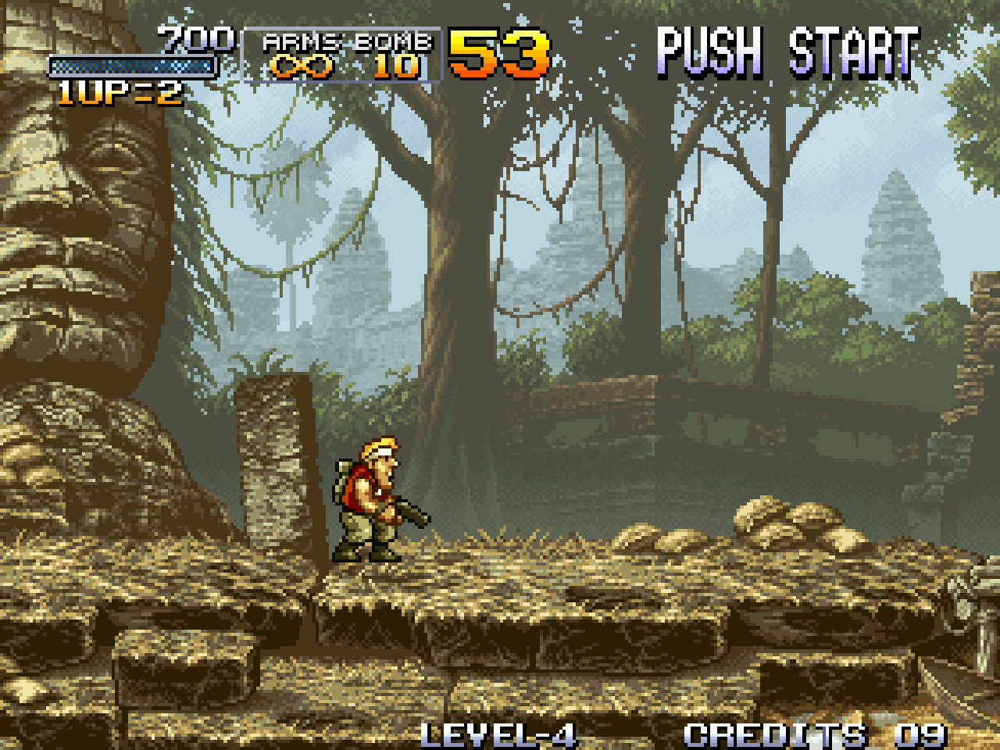</td>
    <td align="center">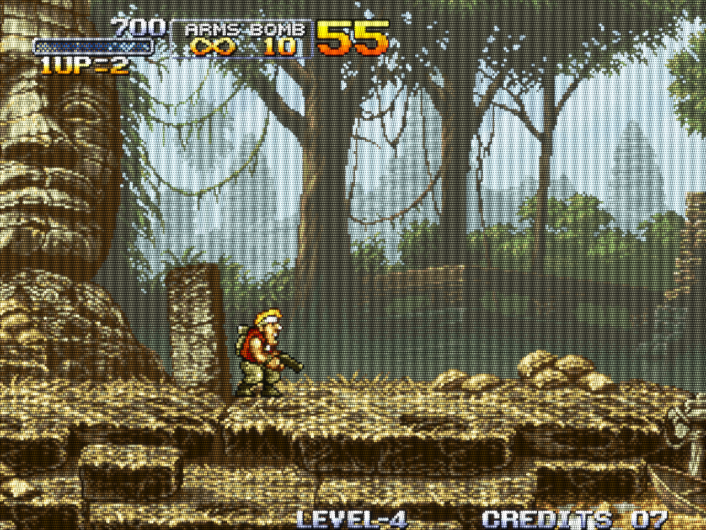</td>
  </tr>
  <tr>
    <td align="center">Raw output (no shader)</td>
    <td align="center">With <code>my-halation-240</code></td>
  </tr>
</table>
<p align="center"><em>Neo Geo (240p) — soft scanlines and Mask 3</em></p>

| RetroArch Parameter | Preset Key | Value |
| :--- | :--- | :--- |
| Gamma Input | `GAMMA_INPUT` | `2.50` |
| Sharpness Horizontal | `SHARPNESS_H` | `0.35` |
| Sharpness Vertical | `SHARPNESS_V` | `0.80` |
| Mask Type | `MASK_TYPE` | `3.00` |
| Mask Strength Min. | `MASK_STRENGTH_MIN` | `0.30` |
| Mask Strength Max. | `MASK_STRENGTH_MAX` | `0.40` |
| Scanline Strength Min. | `SCANLINE_STRENGTH_MIN` | `0.15` |
| Scanline Strength Max. | `SCANLINE_STRENGTH_MAX` | `0.85` |
| Scanline Beam Min. | `SCANLINE_BEAM_MIN` | `0.90` |
| Scanline Beam Max. | `SCANLINE_BEAM_MAX` | `1.10` |
| Brightness | `BRIGHTNESS` | `1.10` |

**`my-halation-240.params`**
```ini
GAMMA_INPUT = "2.500000"
SHARPNESS_H = "0.350000"
SHARPNESS_V = "0.800000"
MASK_TYPE = "3.000000"
MASK_STRENGTH_MIN = "0.300000"
MASK_STRENGTH_MAX = "0.400000"
SCANLINE_STRENGTH_MIN = "0.150000"
SCANLINE_STRENGTH_MAX = "0.850000"
SCANLINE_BEAM_MIN = "0.900000"
SCANLINE_BEAM_MAX = "1.100000"
BRIGHTNESS = "1.100000"
```

**`my-halation-240.slangp`**
```ini
#reference "shaders_slang/crt/crt-easymode-halation.slangp"
#reference "my-halation-240.params"
```

**`my-halation-240.glslp`**
```ini
#reference "shaders_glsl/crt/crt-easymode-halation.glslp"
#reference "my-halation-240.params"
```

### 480p Systems: `my-halation-480`

Disables both scanlines and fake interlacing (`INTERLACING_TOGGLE = 0.00`) for clean progressive 480p output (e.g., Dreamcast VGA). Uses `Mask 4` so the organic phosphor grain remains perceptible on the 4.5" OLED without scanlines.

<table>
  <tr>
    <td align="center">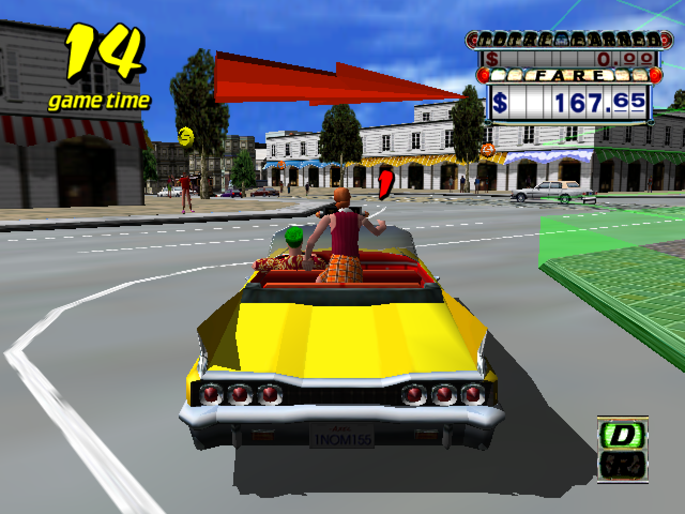</td>
    <td align="center">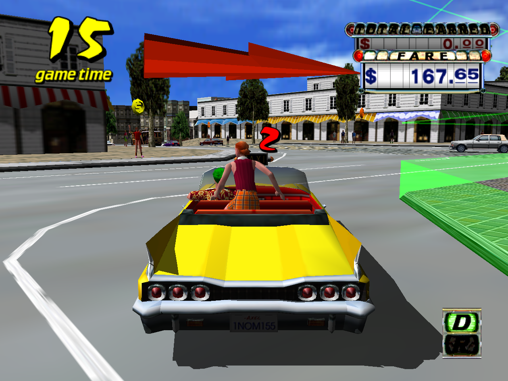</td>
    <td align="center">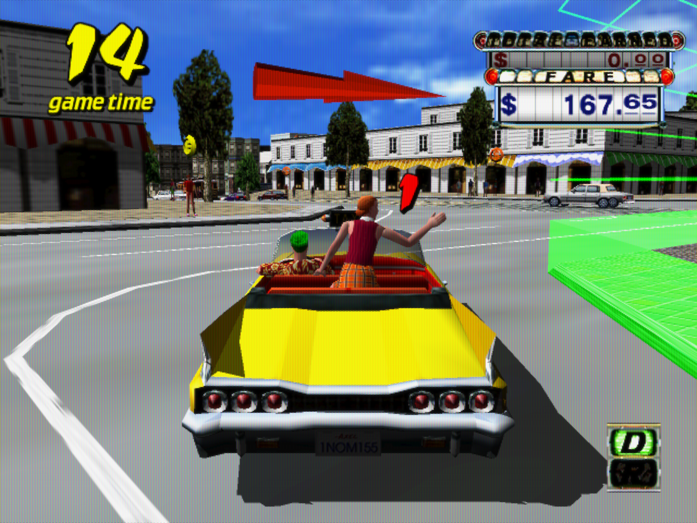</td>
  </tr>
  <tr>
    <td align="center">1× raw</td>
    <td align="center">2× raw</td>
    <td align="center">2× + <code>my-ssaa-05x</code> + <code>my-halation-480</code></td>
  </tr>
</table>
<p align="center"><em>Dreamcast (480p VGA) — progressive Mask 4 without scanlines</em></p>

| RetroArch Parameter | Preset Key | Value |
| :--- | :--- | :--- |
| Sharpness Horizontal | `SHARPNESS_H` | `0.50` |
| Sharpness Vertical | `SHARPNESS_V` | `0.60` |
| Mask Type | `MASK_TYPE` | `4.00` |
| Mask Strength Max. | `MASK_STRENGTH_MAX` | `0.45` |
| Scanline Strength Min. | `SCANLINE_STRENGTH_MIN` | `0.00` |
| Scanline Strength Max. | `SCANLINE_STRENGTH_MAX` | `0.00` |
| Interlacing Toggle | `INTERLACING_TOGGLE` | `0.00` |
| Brightness | `BRIGHTNESS` | `1.15` |

**`my-halation-480.params`**
```ini
SHARPNESS_H = "0.500000"
SHARPNESS_V = "0.600000"
MASK_TYPE = "4.000000"
MASK_STRENGTH_MAX = "0.450000"
SCANLINE_STRENGTH_MIN = "0.000000"
SCANLINE_STRENGTH_MAX = "0.000000"
INTERLACING_TOGGLE = "0.000000"
BRIGHTNESS = "1.150000"
```

**`my-halation-480.slangp`**
```ini
#reference "shaders_slang/crt/crt-easymode-halation.slangp"
#reference "my-halation-480.params"
```

**`my-halation-480.glslp`**
```ini
#reference "shaders_glsl/crt/crt-easymode-halation.glslp"
#reference "my-halation-480.params"
```

### 2× → 1× SSAA Prepend: `my-ssaa-05x`

For 3D cores without built-in antialiasing (e.g., Flycast at 2× `1280×960`, or PS1/N64 at 2×), prepend this preset before `my-halation-240` or `my-halation-480`. It performs an exact 2×2 box-average downscale back to native resolution before the CRT shader runs, smoothing 3D jaggies while keeping 2D elements cohesive.

<table>
  <tr>
    <td align="center">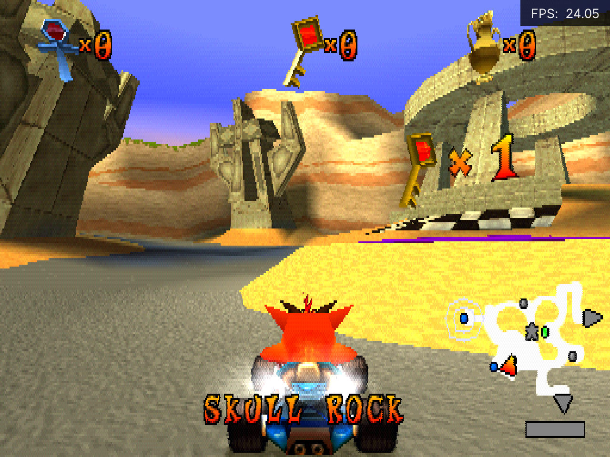</td>
    <td align="center">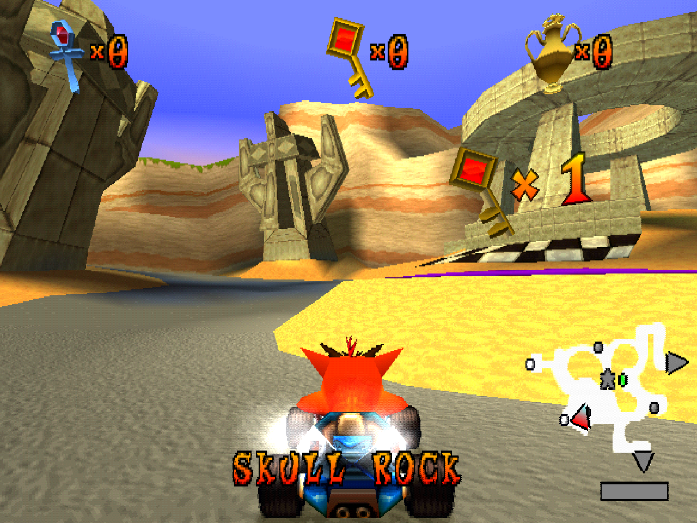</td>
    <td align="center">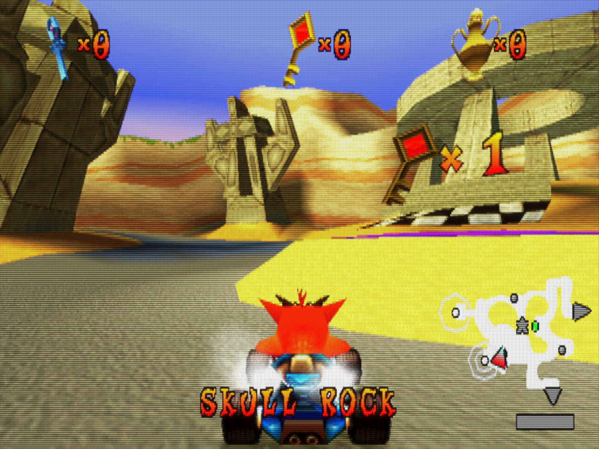</td>
  </tr>
  <tr>
    <td align="center">1× raw</td>
    <td align="center">2× raw</td>
    <td align="center">2× + <code>my-ssaa-05x</code> + <code>my-halation-240</code></td>
  </tr>
</table>
<p align="center"><em>PlayStation (240p 3D) — 2× SSAA downscale into CRT scanlines</em></p>

**`my-ssaa-05x.slangp`**
```ini
shaders = "1"
shader0 = "shaders_slang/stock.slang"
filter_linear0 = "true"
scale_type0 = "source"
scale0 = "0.500000"
```

**`my-ssaa-05x.glslp`**
```ini
shaders = "1"
shader0 = "shaders_glsl/stock.glsl"
filter_linear0 = "true"
scale_type0 = "source"
scale0 = "0.500000"
```

### PlayStation Portable (`PPSSPP` — 4:3 Patched Games)

On a 4:3 screen, native 16:9 PSP (`480×272`) leaves massive letterboxing (and at `2×` integer, `lcd1x` produces no grid at all). The chosen philosophy is to limit the library to titles supporting **4:3 CWCheat patches** and fill the full `1280×960` viewport:
- **Why a CRT shader instead of an LCD grid:** 4:3 patches are *anamorphic*—they widen the 3D projection matrix inside the fixed `480×272` framebuffer so 3D geometry displays with exact 4:3 proportions once stretched to `1280×960` (only 2D HUD/menus are horizontally compressed). Because the resulting scaling factors are fractional and asymmetric (`2.667×` H / `3.529×` V), integer scaling and `lcd1x` grids cause moiré and irregular rectangular cells. `crt-easymode-halation` handles non-integer, non-square pixels cleanly.
- **2× core rendering + SSAA:** running the core at `2×` (`960×544`) and prepending `my-ssaa-05x` performs a 2×2 box-filter downscale back to `480×272` before the CRT shader, eliminating 3D aliasing without losing the retro texture.

Two CRT styles are viable depending on whether you prioritize hardware generation or screen readability:
1. **480p progressive style (generationally aligned):** In hardware terms, the PSP sits in the 6th generation alongside Dreamcast/PS2 rather than PS1. Feeding `2×` (`960×544`) directly—or `4×` + `my-ssaa-05x`—into **`my-halation-480`** (`Mask 4`, no scanlines) matches the Dreamcast/PS2/GameCube look, though a mask-only shader stays fairly subtle on the Nova's 4.5" screen.
2. **240p/272p scanline style — *Preferred*:** Running **`2×` + `my-ssaa-05x` + `my-halation-240`** (`Mask 3` + soft scanlines). Because the PSP's native vertical resolution (`272p`, `3.53 px/line` on `960p`) is much closer to `240p`/`256p` than `480p`, scanlines fit naturally and remain clearly visible on the compact 4.5" OLED where shadow masks alone fade out.

**Required Core & RetroArch Settings (`PPSSPP` Core Override):**
- **Core Options → Internal Resolution:** `960×544 (2x)` (with 4:3 CWCheat patch enabled per game)
- **Video → Scaling → Aspect Ratio:** `4:3` (or `Full`)
- **Video → Scaling → Integer Scale:** `OFF`
- **Shader Chain:** `my-ssaa-05x.slangp` + `my-halation-240.slangp`

---

## RetroArch LCD Shaders

Some handheld consoles had backlit screens, while others used unlit reflective or front-lit screens. Reflective and front-lit screens rely on a light-colored backing to bounce light back to the viewer, so shaders with bright grid lines make more sense. Conversely, for consoles with backlit screens, dark grid lines are more accurate.

| Console | Original Screen Technology | Emulation Grid / Lighting Style |
| :--- | :--- | :--- |
| **Game Boy (GB / DMG)** | Unlit passive LCD (reflective) | **Light grid** (simulates ambient light / reflective background) |
| **Game Boy Color (GBC)** | Unlit reflective LCD | **Light grid** (simulates ambient light) |
| **Game Boy Advance (GBA Original)** | Unlit reflective LCD (very dim) | **Light grid** (plus gamma/brightness correction) |
| **Game Boy Advance SP (AGS-001)** | Front-lit LCD | **Neutral / Light grid** (front-light simulation) |
| **Game Boy Advance SP (AGS-101)** | Backlit LCD | **Dark grid** (standard backlit display) |
| **WonderSwan (Mono / Color / Crystal)** | Unlit reflective STN/TFT LCD | **Light grid** (reflective background) |
| **Neo Geo Pocket Color (NGPC)** | Unlit reflective STN LCD | **Light grid** (reflective background) |
| **PlayStation Portable (PSP)** | Backlit TFT LCD (16:9) | **CRT scanlines** (4:3-patched full-screen; see *RetroArch CRT Shaders*) |
| **Nintendo DS (Phat / Lite)** | Backlit TFT LCD | **Dark grid** (standard backlit display) |
| **Nintendo 3DS** | Backlit TFT LCD | **Dark grid** (custom 3×/1× layout shader below) |

### Dark Grid (Backlit): `my-lcd1x.slangp`

Setting `BRIGHTEN_SCANLINES` and `BRIGHTEN_LCD` to the exact same value (`16.00`) produces a uniform, square horizontal/vertical grid with identical average luminance across `3×`, `4×`, and `5×` integer scales (reusable as-is on GBA `5×`, NDS `5×`, and 3DS `3×`).

| RetroArch Parameter | Preset Key | Value |
| :--- | :--- | :--- |
| Brighten Scanlines | `BRIGHTEN_SCANLINES` | `16.00` |
| Brighten LCD | `BRIGHTEN_LCD` | `16.00` |

```ini
#reference "shaders_slang/handheld/lcd1x.slangp"

BRIGHTEN_SCANLINES = "16.000000"
BRIGHTEN_LCD = "16.000000"
```

### Light Grid (Reflective / Front-lit): `my-simpletex.slangp`

| RetroArch Parameter | Preset Key | Value |
| :--- | :--- | :--- |
| Grid Intensity | `GRID_INTENSITY` | `0.60` |
| Grid Width | `GRID_WIDTH` | `0.60` |
| Grid Bias | `GRID_BIAS` | `0.70` |
| Darken Colour | `DARKEN_COLOUR` | `0.45` |
| Background Intensity | `BACKGROUND_INTENSITY` | `0.00` |

```ini
#reference "shaders_slang/handheld/simpletex_lcd.slangp"

GRID_INTENSITY = "0.600000"
GRID_WIDTH = "0.600000"
GRID_BIAS = "0.700000"
DARKEN_COLOUR = "0.450000"
BACKGROUND_INTENSITY = "0.000000"
```

### Nintendo 3DS (`Azahar`): `my-azahar-3x1x-lcd1x`

On `1280×960`, a stacked **3× / 1×** layout (`1200×720` top + `320×240` bottom) is the mathematical optimum for strict integer scaling on both 3DS screens (76.6% screen coverage). Because Azahar centers the narrower `320×240` screen inside the `400px`-wide Top-Bottom framebuffer, both halves share the same horizontal center axis, making `Swap Screen` work cleanly with zero swap-detection logic (the multiplicative `lcd1x` grid keeps pure `#000000` sidebars on OLED).

Official `lcd1x.slang` derives its grid from `OriginalSize` (which breaks on stacked and supersampled framebuffers), so this 2-pass Slang chain handles SSAA downscaling, layout, grid, and luminance matching in one pipeline:
- **Pass 0 (`my-azahar-vertical-ssaa2x.slang`):** exact 2×2 / 4×4 box-filter SSAA downscale (in linear light) back to native `400×480` when the core renders at `2×` or `4×`, with automatic pass-through at `1×`.
- **Pass 1 (`my-azahar-3x1x-lcd1x.slang`):** renders the top screen at exact `3×` (`1200×720`, `y = 0..719`, ending on a dimmed grid row at `y = 719`) with top-only `lcd1x` grid, inserts a `2px` pure-black gap (`y = 720..721`), and anchors the grid-free `1×` bottom screen cropped by `1px` top and bottom (`238px` tall, `y = 722..959`) to the bottom edge.
- **Luminance homogeneity without highlight clipping:** rather than boosting `TOP_BRIGHTNESS` (which clips bright whites and washes out the grid), `TOP_BRIGHTNESS` stays at `1.00` while `BOTTOM_BRIGHTNESS` (`0.89`, or automatic via `BOTTOM_AUTO_MATCH = 1.0`) trims the raw `1×` screen to match the exact average physical luminance of the `16 / 16` `3×` grid across the entire tone curve.

**Required Core & RetroArch Settings (`Azahar` Core Override):**
- **Core Options → Screen Layout:** `Default Top-Bottom`
- **Core Options → Resolution Scale Factor:** `2x` (or `4x` / `1x`; avoid `3x`)
- **Video → Scaling → Aspect Ratio:** `Full` (or `4:3`, ensuring a `1280×960` viewport)
- **Video → Scaling → Integer Scale:** `OFF`

Place all three files in the same folder and load `my-azahar-3x1x-lcd1x.slangp`. Both `.slang` files keep neutral defaults while personal values live at the bottom of the `.slangp`. Full shader sources are in the Appendix.

| RetroArch Parameter | Preset Key | Scope | Value |
| :--- | :--- | :--- | :--- |
| SSAA Linear Light | `SSAA_LINEAR` | Both | `1.00` (`0` = sRGB, `1` = Gamma 2.0) |
| Top 3x: Brighten Scanlines | `BRIGHTEN_SCANLINES` | Top 3× only | `16.00` (matches `my-lcd1x`) |
| Top 3x: Brighten LCD | `BRIGHTEN_LCD` | Top 3× only | `16.00` (equal H/V grid) |
| Top 3x: Brightness Compensation | `TOP_BRIGHTNESS` | Top 3× only | `1.00` (no highlight clipping) |
| Top 3x: Gamma Lift | `TOP_GAMMA` | Top 3× only | `1.00` (off) |
| Bottom 1x: Auto-Match Top Luminance | `BOTTOM_AUTO_MATCH` | Bottom 1× only | `0.00` (`1.00` = auto match) |
| Bottom 1x: Brightness Trim | `BOTTOM_BRIGHTNESS` | Bottom 1× only | `0.89` (matches `16 / 16` grid) |

**`my-azahar-3x1x-lcd1x.slangp`**
```ini
shaders = "2"

shader0 = "my-azahar-vertical-ssaa2x.slang"
filter_linear0 = "true"
wrap_mode0 = "clamp_to_edge"
scale_type0 = "absolute"
scale_x0 = "400"
scale_y0 = "480"

shader1 = "my-azahar-3x1x-lcd1x.slang"
filter_linear1 = "false"
wrap_mode1 = "clamp_to_edge"
scale_type1 = "viewport"
scale_x1 = "1.000000"
scale_y1 = "1.000000"

SSAA_LINEAR = "1.000000"
BRIGHTEN_SCANLINES = "16.000000"
BRIGHTEN_LCD = "16.000000"
TOP_BRIGHTNESS = "1.000000"
TOP_GAMMA = "1.000000"
BOTTOM_AUTO_MATCH = "0.000000"
BOTTOM_BRIGHTNESS = "0.890000"
```

---

## Standalone Emulators (Single-Pass Shaders)

Dolphin's post-processing pipeline is strictly single-pass, and ARMSX2 benefits from skipping unused blur passes. Both standalone shaders consolidate `crt-easymode-halation` into a single pass with:
- **Automatic 2× → 1× SSAA:** detects internal resolutions above 700p and leverages hardware bilinear sampling for a 1-tap 2×2 box average.
- **Conditional bypass:** setting `HALATION = 0.00` and `DIFFUSION = 0.00` skips the 13-tap Gaussian blur completely (~43% fewer texture reads); setting `SCANLINE_STRENGTH_MIN/MAX = 0.00` skips scanline supersampling.

### ARMSX2: `my-armsx2-halation`

Place all four files in the same folder and load `my-armsx2-halation.slangp` in ARMSX2. Full source for `my-armsx2-halation.slang` is in the Appendix.

<table>
  <tr>
    <td align="center">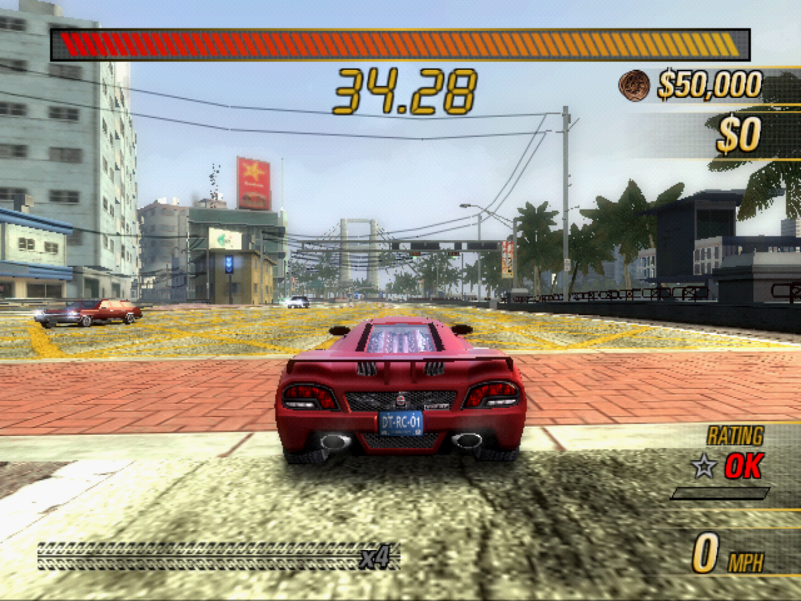</td>
    <td align="center">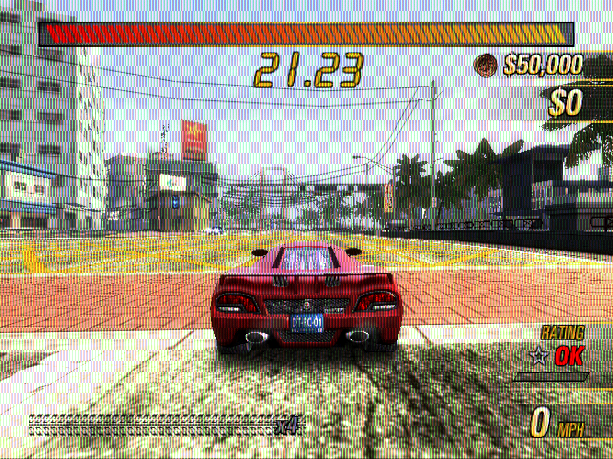</td>
  </tr>
  <tr>
    <td align="center">1× raw</td>
    <td align="center">1× + <code>my-armsx2-halation</code></td>
  </tr>
  <tr>
    <td align="center">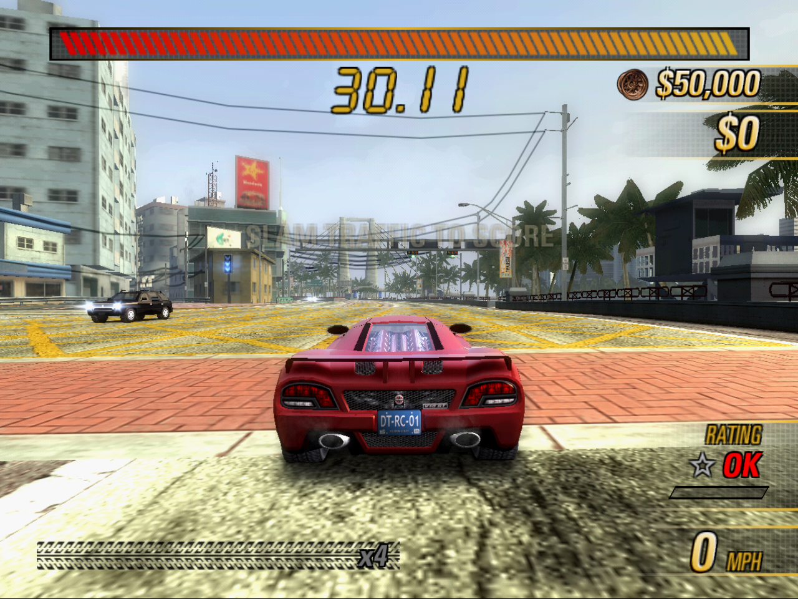</td>
    <td align="center">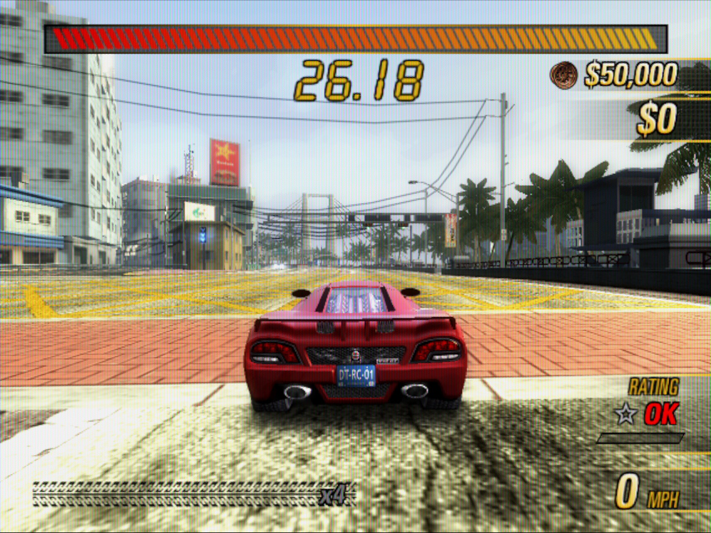</td>
  </tr>
  <tr>
    <td align="center">2× raw</td>
    <td align="center">2× + auto SSAA + <code>my-armsx2-halation</code></td>
  </tr>
</table>
<p align="center"><em>PlayStation 2 (ARMSX2) — 1× vs. 2× with automatic SSAA downscale</em></p>

**`my-armsx2-halation.params`**
```ini
SHARPNESS_H = "0.500000"
SHARPNESS_V = "0.600000"
MASK_TYPE = "4.000000"
MASK_STRENGTH_MAX = "0.450000"
SCANLINE_STRENGTH_MIN = "0.000000"
SCANLINE_STRENGTH_MAX = "0.000000"
HALATION = "0.000000"
BRIGHTNESS = "1.150000"
```

**`my-armsx2-halation-base.slangp`**
```ini
shaders = "1"

shader0 = "my-armsx2-halation.slang"
filter_linear0 = "true"
scale_type0 = "viewport"
```

**`my-armsx2-halation.slangp`**
```ini
#reference "my-armsx2-halation-base.slangp"
#reference "my-armsx2-halation.params"
```

### Dolphin: `my-dolphin-halation.glsl`

Place `my-dolphin-halation.glsl` in Dolphin's user `Shaders/` directory and select it under *Graphics Settings → Enhancements → Post-Processing Effect*. Defaults match `my-halation-480.params` and can be tweaked directly in Dolphin's UI. Full source is in the Appendix.

---

## Appendix: Full Custom Shader Sources

### `my-azahar-vertical-ssaa2x.slang`

```glsl
#version 450

/*
   my-azahar-vertical-ssaa2x.slang

   2x/4x box-filter SSAA downscaler to native 3DS Top-Bottom resolution (400x480)
   for the Azahar (libretro) core. Bypasses filtering when the core runs at 1x.

   Boilerplate structure based on stock.slang (libretro/slang-shaders, Themaister / hunterk).
   SSAA box-filter downscaling logic vibe coded by Gemini.

   Released into the public domain.
*/

#pragma parameter SSAA_LINEAR "SSAA Linear Light (0=sRGB, 1=Gamma 2.0)" 1.0 0.0 1.0 1.0

layout(push_constant) uniform Push
{
    vec4 SourceSize;
    vec4 OriginalSize;
    vec4 OutputSize;
    float SSAA_LINEAR;
} params;

layout(std140, set = 0, binding = 0) uniform UBO
{
    mat4 MVP;
} global;

#pragma stage vertex
layout(location = 0) in vec4 Position;
layout(location = 1) in vec2 TexCoord;
layout(location = 0) out vec2 vTexCoord;

void main()
{
    gl_Position = global.MVP * Position;
    vTexCoord = TexCoord;
}

#pragma stage fragment
layout(location = 0) in vec2 vTexCoord;
layout(location = 0) out vec4 FragColor;
layout(set = 0, binding = 2) uniform sampler2D Source;

void main()
{
    // Core at 1x (400x480): exact pass-through
    if (params.SourceSize.x < 600.0)
    {
        FragColor = texture(Source, vTexCoord);
        return;
    }

    // Core at 2x (800x960) or 4x (1600x1920): exact SSAA box-filter without top/bottom bleed
    const vec2 d = vec2(0.25 / 400.0, 0.25 / 480.0);
    vec3 c00 = texture(Source, vTexCoord + vec2(-d.x, -d.y)).rgb;
    vec3 c10 = texture(Source, vTexCoord + vec2( d.x, -d.y)).rgb;
    vec3 c01 = texture(Source, vTexCoord + vec2(-d.x,  d.y)).rgb;
    vec3 c11 = texture(Source, vTexCoord + vec2( d.x,  d.y)).rgb;

    vec3 avg;
    if (params.SSAA_LINEAR > 0.5)
    {
        // Linear-light average (gamma 2.0: preserves 3D edge energy, NaN-safe on pure black)
        avg = sqrt(0.25 * (c00 * c00 + c10 * c10 + c01 * c01 + c11 * c11));
    }
    else
    {
        avg = 0.25 * (c00 + c10 + c01 + c11);
    }

    FragColor = vec4(avg, 1.0);
}
```

### `my-azahar-3x1x-lcd1x.slang`

```glsl
#version 450

/*
   my-azahar-3x1x-lcd1x.slang

   Integer-scaled 3x/1x stacked layout for the Azahar (libretro) core on
   1280x960 (4:3) displays:
   - Top screen at 3x (1200x720, y in [0..719]) with the lcd1x grid (ends on a
     dimmed grid row at y=719) plus top-only brightness/gamma compensation.
   - 2px pure-black gap (y in [720..721]).
   - Bottom screen at raw 1x without grid, cropped by 1px top and 1px bottom
     (238px tall, y in [722..959]), aligned to the bottom edge, with optional
     luminance matching to the 3x grid.

   LCD grid formula based on handheld/shaders/lcd1x.slang (libretro/slang-shaders):
   > Original lcd3x code written by Gigaherz and released into the public domain.
   > Edited as lcd1x by jdgleaver (omits LCD colour separation, aligns scanlines).

   Layout adaptation and integration vibe coded by Gemini.

   This program is free software; you can redistribute it and/or modify it
   under the terms of the GNU General Public License as published by the Free
   Software Foundation; either version 2 of the License, or (at your option)
   any later version.
*/

#pragma parameter BRIGHTEN_SCANLINES "Top 3x: Brighten Scanlines" 16.0 1.0 64.0 0.5
#pragma parameter BRIGHTEN_LCD "Top 3x: Brighten LCD" 4.0 1.0 64.0 0.1
#pragma parameter TOP_BRIGHTNESS "Top 3x: Brightness Compensation" 1.00 0.50 2.00 0.02
#pragma parameter TOP_GAMMA "Top 3x: Gamma Lift (1.0=Off)" 1.00 0.50 2.00 0.05
#pragma parameter BOTTOM_AUTO_MATCH "Bottom 1x: Auto-Match Top Luminance" 0.0 0.0 1.0 1.0
#pragma parameter BOTTOM_BRIGHTNESS "Bottom 1x: Brightness Trim" 1.00 0.50 1.20 0.01

layout(push_constant) uniform Push
{
    vec4 SourceSize;
    vec4 OriginalSize;
    vec4 OutputSize;
    float BRIGHTEN_SCANLINES;
    float BRIGHTEN_LCD;
    float TOP_BRIGHTNESS;
    float TOP_GAMMA;
    float BOTTOM_AUTO_MATCH;
    float BOTTOM_BRIGHTNESS;
} params;

layout(std140, set = 0, binding = 0) uniform UBO
{
    mat4 MVP;
} global;

#pragma stage vertex
layout(location = 0) in vec4 Position;
layout(location = 1) in vec2 TexCoord;
layout(location = 0) out vec2 vTexCoord;

void main()
{
    gl_Position = global.MVP * Position;
    vTexCoord = TexCoord;
}

#pragma stage fragment
layout(location = 0) in vec2 vTexCoord;
layout(location = 0) out vec4 FragColor;
layout(set = 0, binding = 2) uniform sampler2D Source; // 400x480 SSAA output from pass 0

#define PI 3.141592654

void main()
{
    vec2 px = floor(vTexCoord * params.OutputSize.xy);

    // Large screen 3x (1200x720 centered on x in [40..1240), y in [0..720))
    if (px.y < 720.0 && px.x >= 40.0 && px.x < 1240.0)
    {
        vec2 local = vec2(px.x - 40.0, px.y);
        vec2 pixelCoord = (local + 0.5) / 3.0;
        vec2 native_px = floor(pixelCoord);
        vec2 uv_top = (native_px + 0.5) / vec2(400.0, 480.0);
        vec3 colour = texture(Source, uv_top).rgb;

        if (abs(params.TOP_GAMMA - 1.0) > 0.001)
        {
            // NaN-safe on mobile GPUs while keeping pure black OLED pixels at 0.0
            colour = pow(max(colour, vec3(1e-6)), vec3(1.0 / params.TOP_GAMMA))
                   * step(vec3(1e-6), colour);
        }

        vec2 angle = 2.0 * PI * (pixelCoord - 0.25);
        float yfactor = (params.BRIGHTEN_SCANLINES + sin(angle.y)) / (params.BRIGHTEN_SCANLINES + 1.0);
        float xfactor = (params.BRIGHTEN_LCD + sin(angle.x)) / (params.BRIGHTEN_LCD + 1.0);

        vec3 top_out = clamp(colour * yfactor * xfactor * params.TOP_BRIGHTNESS, 0.0, 1.0);
        FragColor = vec4(top_out, 1.0);
        return;
    }

    // 2px pure-black gap at y=720 and y=721

    // Small screen 1x without grid, cropped 1px top & 1px bottom (native y in [1..238]),
    // anchored to the bottom edge (y in [722..960), x in [440..840))
    if (px.y >= 722.0 && px.y < 960.0 && px.x >= 440.0 && px.x < 840.0)
    {
        float bot_x = px.x - 440.0;
        float bot_y = (px.y - 722.0) + 1.0;
        vec2 uv_bot = (vec2(bot_x, 240.0 + bot_y) + 0.5) / vec2(400.0, 480.0);
        vec3 bot_col = texture(Source, uv_bot).rgb;

        float bot_gain = params.BOTTOM_BRIGHTNESS;
        if (params.BOTTOM_AUTO_MATCH > 0.5)
        {
            // Exact average physical luminance ratio (gamma 2.2) of the 3x3 lcd1x block
            float ye = (params.BRIGHTEN_SCANLINES - 0.5) / (params.BRIGHTEN_SCANLINES + 1.0);
            float xe = (params.BRIGHTEN_LCD - 0.5) / (params.BRIGHTEN_LCD + 1.0);
            float ly = (1.0 + 2.0 * pow(max(ye, 1e-6), 2.2)) / 3.0;
            float lx = (1.0 + 2.0 * pow(max(xe, 1e-6), 2.2)) / 3.0;
            bot_gain *= pow(lx * ly, 1.0 / 2.2);
        }

        FragColor = vec4(clamp(bot_col * bot_gain, 0.0, 1.0), 1.0);
        return;
    }

    FragColor = vec4(0.0, 0.0, 0.0, 1.0);
}
```

### `my-armsx2-halation.slang`

```glsl
#version 450

/*
    my-armsx2-halation.slang
    Standalone single-pass Slang shader for ARMSX2 (librashader) and RetroArch.

    Credits & Provenance:
    - Vibe-coded by Gemini, based on the original crt-easymode-halation shader by EasyMode (GPL).
    - Consolidates linearize, horizontal/vertical blur, threshold, and CRT passes into a single pass.
    - Features automatic 2x->1x SSAA downscale (requires filter_linear0 = "true" in the preset),
      plus conditional bypass for scanlines and halation/diffusion when their strengths are 0.0.
*/

layout(push_constant) uniform Push
{
    vec4 SourceSize;
    vec4 OutputSize;
    float AUTO_DOWNSCALE;
    float FORCE_DOWNSCALE_2X;
    float GAMMA_INPUT;
    float GAMMA_OUTPUT;
    float SHARPNESS_H;
    float SHARPNESS_V;
    float MASK_TYPE;
    float MASK_STRENGTH_MIN;
    float MASK_STRENGTH_MAX;
    float MASK_SIZE;
    float SCANLINE_STRENGTH_MIN;
    float SCANLINE_STRENGTH_MAX;
    float SCANLINE_BEAM_MIN;
    float SCANLINE_BEAM_MAX;
    float HALATION;
    float DIFFUSION;
    float BRIGHTNESS;
} params;

#pragma parameter AUTO_DOWNSCALE "Auto Downscale 2x -> 1x (SSAA)" 1.0 0.0 1.0 1.0
#pragma parameter FORCE_DOWNSCALE_2X "Force Downscale 2x (for 240p at 2x)" 0.0 0.0 1.0 1.0
#pragma parameter GAMMA_INPUT "Gamma Input" 2.4 0.1 5.0 0.01
#pragma parameter GAMMA_OUTPUT "Gamma Output" 2.2 0.1 5.0 0.01
#pragma parameter SHARPNESS_H "Sharpness Horizontal" 0.6 0.0 1.0 0.05
#pragma parameter SHARPNESS_V "Sharpness Vertical" 1.0 0.0 1.0 0.05
#pragma parameter MASK_TYPE "Mask Type" 4.0 0.0 7.0 1.0
#pragma parameter MASK_STRENGTH_MIN "Mask Strength Min." 0.2 0.0 0.5 0.01
#pragma parameter MASK_STRENGTH_MAX "Mask Strength Max." 0.2 0.0 0.5 0.01
#pragma parameter MASK_SIZE "Mask Size" 1.0 1.0 100.0 1.0
#pragma parameter SCANLINE_STRENGTH_MIN "Scanline Strength Min." 0.2 0.0 1.0 0.05
#pragma parameter SCANLINE_STRENGTH_MAX "Scanline Strength Max." 0.4 0.0 1.0 0.05
#pragma parameter SCANLINE_BEAM_MIN "Scanline Beam Min." 1.0 0.25 5.0 0.05
#pragma parameter SCANLINE_BEAM_MAX "Scanline Beam Max." 1.0 0.25 5.0 0.05
#pragma parameter HALATION "Halation (0 = skip blur)" 0.03 0.0 1.0 0.01
#pragma parameter DIFFUSION "Diffusion" 0.0 0.0 1.0 0.01
#pragma parameter BRIGHTNESS "Brightness" 1.0 0.0 2.0 0.05

layout(std140, set = 0, binding = 0) uniform UBO
{
    mat4 MVP;
} global;

#pragma stage vertex
layout(location = 0) in vec4 Position;
layout(location = 1) in vec2 TexCoord;
layout(location = 0) out vec2 vTexCoord;

void main()
{
    gl_Position = global.MVP * Position;
    vTexCoord = TexCoord;
}

#pragma stage fragment
layout(location = 0) in vec2 vTexCoord;
layout(location = 0) out vec4 FragColor;
layout(set = 0, binding = 2) uniform sampler2D Source;

#define PI 3.141592653589793
#define FIX(c) max(abs(c), vec4(1e-5))

float curve_distance(float x, float sharp)
{
    float x_step = step(0.5, x);
    float d = x - x_step;
    float curve = 0.5 - sqrt(max(0.25 - d * d, 0.0)) * sign(0.5 - x);
    return mix(x, curve, sharp);
}

vec3 fetch_linear(vec2 uv, float gamma_in)
{
    vec2 clamped_uv = clamp(uv, vec2(0.0), vec2(1.0));
    vec3 c = texture(Source, clamped_uv).rgb;
    return pow(max(c, vec3(1e-6)), vec3(gamma_in));
}

vec3 filter_lanczos_row(vec2 co, vec2 dx, vec4 coeffs, float gamma_in)
{
    vec3 c0 = fetch_linear(co - dx, gamma_in);
    vec3 c1 = fetch_linear(co, gamma_in);
    vec3 c2 = fetch_linear(co + dx, gamma_in);
    vec3 c3 = fetch_linear(co + 2.0 * dx, gamma_in);

    vec3 col = c0 * coeffs.x + c1 * coeffs.y + c2 * coeffs.z + c3 * coeffs.w;
    vec3 sample_min = min(c1, c2);
    vec3 sample_max = max(c1, c2);
    return clamp(col, sample_min, sample_max);
}

vec3 filter_lanczos_col(vec3 r0, vec3 r1, vec3 r2, vec3 r3, vec4 coeffs)
{
    vec3 col = r0 * coeffs.x + r1 * coeffs.y + r2 * coeffs.z + r3 * coeffs.w;
    vec3 sample_min = min(r1, r2);
    vec3 sample_max = max(r1, r2);
    return clamp(col, sample_min, sample_max);
}

float get_scanline_weight(float pos, float beam, float strength)
{
    float c = max(cos(pos * 2.0 * PI) * 0.5 + 0.5, 1e-6);
    float weight = 1.0 - pow(c, beam);
    return weight * strength * 2.0 + (1.0 - strength);
}

vec3 compute_halation_diff(vec2 xy, vec2 step_uv, vec3 center_linear, float gamma_in)
{
    // Compact 13-tap 2D Gaussian matching GLOW_FALLOFF = 0.35 (radius 2)
    const float w0 = 1.000000;
    const float w1 = 0.704688; // exp(-0.35 * 1)
    const float w2 = 0.496585; // exp(-0.35 * 2)
    const float w4 = 0.246597; // exp(-0.35 * 4)
    const float k_total = w0 + 4.0 * w1 + 4.0 * w2 + 4.0 * w4;

    vec2 sx = vec2(step_uv.x, 0.0);
    vec2 sy = vec2(0.0, step_uv.y);

    vec3 blur = center_linear * w0;

    blur += (fetch_linear(xy - sx, gamma_in) + fetch_linear(xy + sx, gamma_in)
          +  fetch_linear(xy - sy, gamma_in) + fetch_linear(xy + sy, gamma_in)) * w1;

    blur += (fetch_linear(xy - sx - sy, gamma_in) + fetch_linear(xy + sx - sy, gamma_in)
          +  fetch_linear(xy - sx + sy, gamma_in) + fetch_linear(xy + sx + sy, gamma_in)) * w2;

    blur += (fetch_linear(xy - 2.0 * sx, gamma_in) + fetch_linear(xy + 2.0 * sx, gamma_in)
          +  fetch_linear(xy - 2.0 * sy, gamma_in) + fetch_linear(xy + 2.0 * sy, gamma_in)) * w4;

    blur /= k_total;
    return clamp(blur - center_linear, vec3(0.0), vec3(1.0));
}

void main()
{
    vec2 uv = vTexCoord;
    vec2 raw_res = params.SourceSize.xy;
    vec2 win_res = params.OutputSize.xy;

    // Auto-detect 2x internal resolution (e.g. >= 896p on PS2) vs 1x (448p-576p)
    bool do_downscale = (params.FORCE_DOWNSCALE_2X > 0.5)
                     || ((params.AUTO_DOWNSCALE > 0.5) && (raw_res.y > 700.0));
    vec2 tex_size = do_downscale ? (raw_res * 0.5) : raw_res;

    vec2 inv_tex = vec2(1.0) / tex_size;
    vec2 dx = vec2(inv_tex.x, 0.0);
    vec2 dy = vec2(0.0, inv_tex.y);

    // In 2x mode, (floor(pix_co) + 0.5) / tex_size lands at the exact midpoint of each 2x2 raw texel block,
    // turning hardware bilinear filtering (filter_linear0 = "true") into an exact 1-tap 2x2 SSAA box average.
    vec2 pix_co = uv * tex_size - vec2(0.5);
    vec2 tex_co = (floor(pix_co) + vec2(0.5)) * inv_tex;
    vec2 dist = fract(pix_co);

    float curve_x = curve_distance(dist.x, params.SHARPNESS_H * params.SHARPNESS_H);
    float curve_y = curve_distance(dist.y, params.SHARPNESS_V * params.SHARPNESS_V);

    vec4 coeffs_x = PI * vec4(1.0 + curve_x, curve_x, 1.0 - curve_x, 2.0 - curve_x);
    vec4 coeffs_y = PI * vec4(1.0 + curve_y, curve_y, 1.0 - curve_y, 2.0 - curve_y);

    coeffs_x = FIX(coeffs_x);
    coeffs_x = 2.0 * sin(coeffs_x) * sin(coeffs_x * 0.5) / (coeffs_x * coeffs_x);
    coeffs_x /= dot(coeffs_x, vec4(1.0));

    coeffs_y = FIX(coeffs_y);
    coeffs_y = 2.0 * sin(coeffs_y) * sin(coeffs_y * 0.5) / (coeffs_y * coeffs_y);
    coeffs_y /= dot(coeffs_y, vec4(1.0));

    vec3 r0 = filter_lanczos_row(tex_co - dy, dx, coeffs_x, params.GAMMA_INPUT);
    vec3 r1 = filter_lanczos_row(tex_co, dx, coeffs_x, params.GAMMA_INPUT);
    vec3 r2 = filter_lanczos_row(tex_co + dy, dx, coeffs_x, params.GAMMA_INPUT);
    vec3 r3 = filter_lanczos_row(tex_co + 2.0 * dy, dx, coeffs_x, params.GAMMA_INPUT);

    vec3 col = filter_lanczos_col(r0, r1, r2, r3, coeffs_y);
    float rgb_max = max(col.r, max(col.g, col.b));

    // CRT Mask (exact EasyMode-Halation Mask 1-7 logic)
    int mask_type = int(params.MASK_TYPE + 0.5);
    vec3 mask_weight = vec3(1.0);
    if (mask_type > 0)
    {
        float mask_colors = 2.0;
        float mask_dot_width = 1.0;
        float mask_dot_height = 1.0;
        float mask_stagger = 0.0;
        float mask_dither = 0.0;

        if      (mask_type == 1) { mask_colors = 2.0; mask_dot_width = 1.0; mask_dot_height = 1.0; mask_stagger = 0.0; mask_dither = 0.0; }
        else if (mask_type == 2) { mask_colors = 3.0; mask_dot_width = 1.0; mask_dot_height = 1.0; mask_stagger = 0.0; mask_dither = 0.0; }
        else if (mask_type == 3) { mask_colors = 2.0; mask_dot_width = 1.0; mask_dot_height = 1.0; mask_stagger = 0.0; mask_dither = 1.0; }
        else if (mask_type == 4) { mask_colors = 3.0; mask_dot_width = 1.0; mask_dot_height = 1.0; mask_stagger = 0.0; mask_dither = 1.0; }
        else if (mask_type == 5) { mask_colors = 2.0; mask_dot_width = 1.0; mask_dot_height = 1.0; mask_stagger = 1.0; mask_dither = 0.0; }
        else if (mask_type == 6) { mask_colors = 3.0; mask_dot_width = 2.0; mask_dot_height = 1.0; mask_stagger = 3.0; mask_dither = 0.0; }
        else if (mask_type == 7) { mask_colors = 3.0; mask_dot_width = 2.0; mask_dot_height = 2.0; mask_stagger = 3.0; mask_dither = 0.0; }

        vec2 mod_fac = floor(uv * win_res / vec2(params.MASK_SIZE, mask_dot_height * params.MASK_SIZE)) * 1.0001;
        int dot_no = int(mod((mod_fac.x + mod(mod_fac.y, 2.0) * mask_stagger) / mask_dot_width, mask_colors));
        float dither = mod(mod_fac.y + mod(floor(mod_fac.x / mask_colors), 2.0), 2.0);

        float mask_strength = mix(params.MASK_STRENGTH_MAX, params.MASK_STRENGTH_MIN, rgb_max);
        float mask_dark = 1.0 - mask_strength;
        float mask_bright = 1.0 + mask_strength * 2.0;

        float color_mix = mask_colors - 2.0;
        if (dot_no == 0)
            mask_weight = mix(vec3(mask_bright), vec3(mask_bright, mask_dark, mask_dark), color_mix);
        else if (dot_no == 1)
            mask_weight = mix(vec3(mask_dark), vec3(mask_dark, mask_bright, mask_dark), color_mix);
        else
            mask_weight = vec3(mask_dark, mask_dark, mask_bright);

        float mask_mul = (dither > 0.9) ? mask_dark : mask_bright;
        mask_weight *= mix(1.0, mask_mul, mask_dither);
    }

    vec3 col2 = col * mask_weight * params.BRIGHTNESS;

    // Scanlines (bypassed cleanly when both strengths are 0.0)
    vec3 out_col;
    if (params.SCANLINE_STRENGTH_MIN > 0.0001 || params.SCANLINE_STRENGTH_MAX > 0.0001)
    {
        float sample_offset = (tex_size.y * params.OutputSize.w) * 0.5;
        float scan_pos = uv.y * tex_size.y;
        float scan_strength = mix(params.SCANLINE_STRENGTH_MAX, params.SCANLINE_STRENGTH_MIN, rgb_max);
        float scan_beam = clamp(rgb_max * params.SCANLINE_BEAM_MAX, params.SCANLINE_BEAM_MIN, params.SCANLINE_BEAM_MAX);

        float w_prev = get_scanline_weight(scan_pos - sample_offset, scan_beam, scan_strength);
        float w_curr = get_scanline_weight(scan_pos, scan_beam, scan_strength);
        float w_next = get_scanline_weight(scan_pos + sample_offset, scan_beam, scan_strength);

        out_col  = clamp(col2 * w_prev, vec3(0.0), vec3(1.0));
        out_col += clamp(col2 * w_curr, vec3(0.0), vec3(1.0));
        out_col += clamp(col2 * w_next, vec3(0.0), vec3(1.0));
        out_col /= 3.0;
    }
    else
    {
        out_col = clamp(col2, vec3(0.0), vec3(1.0));
    }

    // Halation / Diffusion (13-tap blur skipped completely when both are 0.0)
    if (params.HALATION > 0.0001 || params.DIFFUSION > 0.0001)
    {
        vec3 diff = compute_halation_diff(uv, inv_tex, col, params.GAMMA_INPUT);
        out_col += diff * mask_weight * params.HALATION;
        out_col += diff * params.DIFFUSION;
    }

    out_col = pow(max(out_col, vec3(0.0)), vec3(1.0 / params.GAMMA_OUTPUT));
    FragColor = vec4(out_col, 1.0);
}
```

### `my-dolphin-halation.glsl`

```glsl
/*
    my-dolphin-halation.glsl
    Single-pass CRT EasyMode Halation with automatic 2x->1x SSAA downscale for Dolphin Emulator.

    Credits & Provenance:
    - Vibe-coded by Gemini, based on the original crt-easymode-halation shader by EasyMode (GPL).
    - Consolidates linearize, blur, threshold, and final CRT passes into a single pass,
      with conditional bypass for both scanlines and halation/diffusion when set to 0.0.
    - Defaults pre-configured from my-halation-480.params.
*/

/*
[configuration]

[OptionBool]
GUIName = Auto Downscale 2x -> 1x (SSAA)
OptionName = AUTO_DOWNSCALE
DefaultValue = true

[OptionBool]
GUIName = Force Downscale 2x (for 240p at 2x)
OptionName = FORCE_DOWNSCALE_2X
DefaultValue = false

[OptionRangeFloat]
GUIName = Gamma Input
OptionName = GAMMA_INPUT
MinValue = 0.10
MaxValue = 5.00
StepAmount = 0.05
DefaultValue = 2.40

[OptionRangeFloat]
GUIName = Gamma Output
OptionName = GAMMA_OUTPUT
MinValue = 0.10
MaxValue = 5.00
StepAmount = 0.05
DefaultValue = 2.20

[OptionRangeFloat]
GUIName = Sharpness Horizontal
OptionName = SHARPNESS_H
MinValue = 0.00
MaxValue = 1.00
StepAmount = 0.05
DefaultValue = 0.50

[OptionRangeFloat]
GUIName = Sharpness Vertical
OptionName = SHARPNESS_V
MinValue = 0.00
MaxValue = 1.00
StepAmount = 0.05
DefaultValue = 0.60

[OptionRangeInteger]
GUIName = Mask Type (0=Off, 1-7)
OptionName = MASK_TYPE
MinValue = 0
MaxValue = 7
StepAmount = 1
DefaultValue = 4

[OptionRangeFloat]
GUIName = Mask Strength Min. (Brights)
OptionName = MASK_STRENGTH_MIN
MinValue = 0.00
MaxValue = 0.50
StepAmount = 0.01
DefaultValue = 0.20

[OptionRangeFloat]
GUIName = Mask Strength Max. (Darks)
OptionName = MASK_STRENGTH_MAX
MinValue = 0.00
MaxValue = 0.50
StepAmount = 0.01
DefaultValue = 0.45

[OptionRangeFloat]
GUIName = Mask Size
OptionName = MASK_SIZE
MinValue = 1.0
MaxValue = 4.0
StepAmount = 1.0
DefaultValue = 1.0

[OptionRangeFloat]
GUIName = Scanline Strength Min. (Brights)
OptionName = SCANLINE_STRENGTH_MIN
MinValue = 0.00
MaxValue = 1.00
StepAmount = 0.05
DefaultValue = 0.00

[OptionRangeFloat]
GUIName = Scanline Strength Max. (Darks)
OptionName = SCANLINE_STRENGTH_MAX
MinValue = 0.00
MaxValue = 1.00
StepAmount = 0.05
DefaultValue = 0.00

[OptionRangeFloat]
GUIName = Scanline Beam Min.
OptionName = SCANLINE_BEAM_MIN
MinValue = 0.25
MaxValue = 5.00
StepAmount = 0.05
DefaultValue = 0.90

[OptionRangeFloat]
GUIName = Scanline Beam Max.
OptionName = SCANLINE_BEAM_MAX
MinValue = 0.25
MaxValue = 5.00
StepAmount = 0.05
DefaultValue = 1.10

[OptionRangeFloat]
GUIName = Halation (0 = skip blur)
OptionName = HALATION
MinValue = 0.00
MaxValue = 0.50
StepAmount = 0.01
DefaultValue = 0.03

[OptionRangeFloat]
GUIName = Diffusion
OptionName = DIFFUSION
MinValue = 0.00
MaxValue = 0.50
StepAmount = 0.01
DefaultValue = 0.00

[OptionRangeFloat]
GUIName = Brightness
OptionName = BRIGHTNESS
MinValue = 0.00
MaxValue = 2.00
StepAmount = 0.05
DefaultValue = 1.15

[/configuration]
*/

#define PI 3.141592653589793
#define FIX(c) max(abs(c), float4(1e-5, 1e-5, 1e-5, 1e-5))

float lerp1(float a, float b, float t)
{
    return a + (b - a) * t;
}

float3 lerp3(float3 a, float3 b, float t)
{
    return a + (b - a) * t;
}

float mod_f(float x, float y)
{
    return x - y * floor(x / y);
}

float2 fract_f2(float2 x)
{
    return x - floor(x);
}

float curve_distance(float x, float sharp)
{
    float x_step = step(0.5, x);
    float d = x - x_step;
    float curve = 0.5 - sqrt(max(0.25 - d * d, 0.0)) * sign(0.5 - x);
    return lerp1(x, curve, sharp);
}

float3 fetch_linear(float2 uv, float gamma_in)
{
    float2 clamped_uv = clamp(uv, float2(0.0, 0.0), float2(1.0, 1.0));
    float3 c = SampleLocation(clamped_uv).rgb;
    return pow(max(c, float3(1e-6, 1e-6, 1e-6)), float3(gamma_in, gamma_in, gamma_in));
}

float3 filter_lanczos_row(float2 co, float2 dx, float4 coeffs, float gamma_in)
{
    float3 c0 = fetch_linear(co - dx, gamma_in);
    float3 c1 = fetch_linear(co, gamma_in);
    float3 c2 = fetch_linear(co + dx, gamma_in);
    float3 c3 = fetch_linear(co + 2.0 * dx, gamma_in);

    float3 col = c0 * coeffs.x + c1 * coeffs.y + c2 * coeffs.z + c3 * coeffs.w;
    float3 sample_min = min(c1, c2);
    float3 sample_max = max(c1, c2);
    return clamp(col, sample_min, sample_max);
}

float3 filter_lanczos_col(float3 r0, float3 r1, float3 r2, float3 r3, float4 coeffs)
{
    float3 col = r0 * coeffs.x + r1 * coeffs.y + r2 * coeffs.z + r3 * coeffs.w;
    float3 sample_min = min(r1, r2);
    float3 sample_max = max(r1, r2);
    return clamp(col, sample_min, sample_max);
}

float get_scanline_weight(float pos, float beam, float strength)
{
    float c = max(cos(pos * 2.0 * PI) * 0.5 + 0.5, 1e-6);
    float weight = 1.0 - pow(c, beam);
    return weight * strength * 2.0 + (1.0 - strength);
}

float3 compute_halation_diff(float2 xy, float2 step_uv, float3 center_linear, float gamma_in)
{
    // Compact 13-tap 2D Gaussian matching GLOW_FALLOFF = 0.35 (radius 2)
    float w0 = 1.000000;
    float w1 = 0.704688; // exp(-0.35 * 1)
    float w2 = 0.496585; // exp(-0.35 * 2)
    float w4 = 0.246597; // exp(-0.35 * 4)
    float k_total = w0 + 4.0 * w1 + 4.0 * w2 + 4.0 * w4;

    float2 sx = float2(step_uv.x, 0.0);
    float2 sy = float2(0.0, step_uv.y);

    float3 blur = center_linear * w0;

    blur += (fetch_linear(xy - sx, gamma_in) + fetch_linear(xy + sx, gamma_in)
          +  fetch_linear(xy - sy, gamma_in) + fetch_linear(xy + sy, gamma_in)) * w1;

    blur += (fetch_linear(xy - sx - sy, gamma_in) + fetch_linear(xy + sx - sy, gamma_in)
          +  fetch_linear(xy - sx + sy, gamma_in) + fetch_linear(xy + sx + sy, gamma_in)) * w2;

    blur += (fetch_linear(xy - 2.0 * sx, gamma_in) + fetch_linear(xy + 2.0 * sx, gamma_in)
          +  fetch_linear(xy - 2.0 * sy, gamma_in) + fetch_linear(xy + 2.0 * sy, gamma_in)) * w4;

    blur /= k_total;
    return clamp(blur - center_linear, float3(0.0, 0.0, 0.0), float3(1.0, 1.0, 1.0));
}

void main()
{
    float2 uv = GetCoordinates();
    float2 raw_res = GetResolution();
    float2 win_res = GetWindowResolution();

    // Auto-detect 2x internal resolution (e.g. >= 896p) vs 1x (448p-576p)
    bool do_downscale = OptionEnabled(FORCE_DOWNSCALE_2X)
                     || (OptionEnabled(AUTO_DOWNSCALE) && raw_res.y > 700.0);
    float2 tex_size = do_downscale ? (raw_res * 0.5) : raw_res;

    float gamma_in = GetOption(GAMMA_INPUT);
    float gamma_out = GetOption(GAMMA_OUTPUT);
    float sharp_h = GetOption(SHARPNESS_H);
    float sharp_v = GetOption(SHARPNESS_V);
    int mask_type = GetOption(MASK_TYPE);
    float mask_str_min = GetOption(MASK_STRENGTH_MIN);
    float mask_str_max = GetOption(MASK_STRENGTH_MAX);
    float mask_size = GetOption(MASK_SIZE);
    float scan_str_min = GetOption(SCANLINE_STRENGTH_MIN);
    float scan_str_max = GetOption(SCANLINE_STRENGTH_MAX);
    float scan_beam_min = GetOption(SCANLINE_BEAM_MIN);
    float scan_beam_max = GetOption(SCANLINE_BEAM_MAX);
    float halation = GetOption(HALATION);
    float diffusion = GetOption(DIFFUSION);
    float brightness = GetOption(BRIGHTNESS);

    float2 inv_tex = float2(1.0, 1.0) / tex_size;
    float2 dx = float2(inv_tex.x, 0.0);
    float2 dy = float2(0.0, inv_tex.y);

    float2 pix_co = uv * tex_size - float2(0.5, 0.5);
    float2 tex_co = (floor(pix_co) + float2(0.5, 0.5)) * inv_tex;
    float2 dist = fract_f2(pix_co);

    float curve_x = curve_distance(dist.x, sharp_h * sharp_h);
    float curve_y = curve_distance(dist.y, sharp_v * sharp_v);

    float4 coeffs_x = PI * float4(1.0 + curve_x, curve_x, 1.0 - curve_x, 2.0 - curve_x);
    float4 coeffs_y = PI * float4(1.0 + curve_y, curve_y, 1.0 - curve_y, 2.0 - curve_y);

    coeffs_x = FIX(coeffs_x);
    coeffs_x = 2.0 * sin(coeffs_x) * sin(coeffs_x * 0.5) / (coeffs_x * coeffs_x);
    coeffs_x /= dot(coeffs_x, float4(1.0, 1.0, 1.0, 1.0));

    coeffs_y = FIX(coeffs_y);
    coeffs_y = 2.0 * sin(coeffs_y) * sin(coeffs_y * 0.5) / (coeffs_y * coeffs_y);
    coeffs_y /= dot(coeffs_y, float4(1.0, 1.0, 1.0, 1.0));

    float3 r0 = filter_lanczos_row(tex_co - dy, dx, coeffs_x, gamma_in);
    float3 r1 = filter_lanczos_row(tex_co, dx, coeffs_x, gamma_in);
    float3 r2 = filter_lanczos_row(tex_co + dy, dx, coeffs_x, gamma_in);
    float3 r3 = filter_lanczos_row(tex_co + 2.0 * dy, dx, coeffs_x, gamma_in);

    float3 col = filter_lanczos_col(r0, r1, r2, r3, coeffs_y);
    float rgb_max = max(col.r, max(col.g, col.b));

    // CRT Mask (exact EasyMode-Halation Mask 1-7 logic)
    float3 mask_weight = float3(1.0, 1.0, 1.0);
    if (mask_type > 0)
    {
        float mask_colors = 2.0;
        float mask_dot_width = 1.0;
        float mask_dot_height = 1.0;
        float mask_stagger = 0.0;
        float mask_dither = 0.0;

        if      (mask_type == 1) { mask_colors = 2.0; mask_dot_width = 1.0; mask_dot_height = 1.0; mask_stagger = 0.0; mask_dither = 0.0; }
        else if (mask_type == 2) { mask_colors = 3.0; mask_dot_width = 1.0; mask_dot_height = 1.0; mask_stagger = 0.0; mask_dither = 0.0; }
        else if (mask_type == 3) { mask_colors = 2.0; mask_dot_width = 1.0; mask_dot_height = 1.0; mask_stagger = 0.0; mask_dither = 1.0; }
        else if (mask_type == 4) { mask_colors = 3.0; mask_dot_width = 1.0; mask_dot_height = 1.0; mask_stagger = 0.0; mask_dither = 1.0; }
        else if (mask_type == 5) { mask_colors = 2.0; mask_dot_width = 1.0; mask_dot_height = 1.0; mask_stagger = 1.0; mask_dither = 0.0; }
        else if (mask_type == 6) { mask_colors = 3.0; mask_dot_width = 2.0; mask_dot_height = 1.0; mask_stagger = 3.0; mask_dither = 0.0; }
        else if (mask_type == 7) { mask_colors = 3.0; mask_dot_width = 2.0; mask_dot_height = 2.0; mask_stagger = 3.0; mask_dither = 0.0; }

        float2 mod_fac = floor(uv * win_res / float2(mask_size, mask_dot_height * mask_size)) * 1.0001;
        int dot_no = int(mod_f((mod_fac.x + mod_f(mod_fac.y, 2.0) * mask_stagger) / mask_dot_width, mask_colors));
        float dither = mod_f(mod_fac.y + mod_f(floor(mod_fac.x / mask_colors), 2.0), 2.0);

        float mask_strength = lerp1(mask_str_max, mask_str_min, rgb_max);
        float mask_dark = 1.0 - mask_strength;
        float mask_bright = 1.0 + mask_strength * 2.0;

        float color_mix = mask_colors - 2.0;
        if (dot_no == 0)
            mask_weight = lerp3(float3(mask_bright, mask_bright, mask_bright), float3(mask_bright, mask_dark, mask_dark), color_mix);
        else if (dot_no == 1)
            mask_weight = lerp3(float3(mask_dark, mask_dark, mask_dark), float3(mask_dark, mask_bright, mask_dark), color_mix);
        else
            mask_weight = float3(mask_dark, mask_dark, mask_bright);

        float mask_mul = (dither > 0.9) ? mask_dark : mask_bright;
        mask_weight *= lerp1(1.0, mask_mul, mask_dither);
    }

    float3 col2 = col * mask_weight * brightness;

    // Scanlines (bypassed cleanly when both strengths are 0.0)
    float3 out_col;
    if (scan_str_min > 0.0001 || scan_str_max > 0.0001)
    {
        float sample_offset = (tex_size.y / win_res.y) * 0.5;
        float scan_pos = uv.y * tex_size.y;
        float scan_strength = lerp1(scan_str_max, scan_str_min, rgb_max);
        float scan_beam = clamp(rgb_max * scan_beam_max, scan_beam_min, scan_beam_max);

        float w_prev = get_scanline_weight(scan_pos - sample_offset, scan_beam, scan_strength);
        float w_curr = get_scanline_weight(scan_pos, scan_beam, scan_strength);
        float w_next = get_scanline_weight(scan_pos + sample_offset, scan_beam, scan_strength);

        out_col  = clamp(col2 * w_prev, float3(0.0, 0.0, 0.0), float3(1.0, 1.0, 1.0));
        out_col += clamp(col2 * w_curr, float3(0.0, 0.0, 0.0), float3(1.0, 1.0, 1.0));
        out_col += clamp(col2 * w_next, float3(0.0, 0.0, 0.0), float3(1.0, 1.0, 1.0));
        out_col /= 3.0;
    }
    else
    {
        out_col = clamp(col2, float3(0.0, 0.0, 0.0), float3(1.0, 1.0, 1.0));
    }

    // Halation / Diffusion (skipped completely when both are 0.0)
    if (halation > 0.0001 || diffusion > 0.0001)
    {
        float3 diff = compute_halation_diff(uv, inv_tex, col, gamma_in);
        out_col += diff * mask_weight * halation;
        out_col += diff * diffusion;
    }

    out_col = pow(max(out_col, float3(0.0, 0.0, 0.0)), float3(1.0 / gamma_out, 1.0 / gamma_out, 1.0 / gamma_out));
    SetOutput(float4(out_col, 1.0));
}
```
